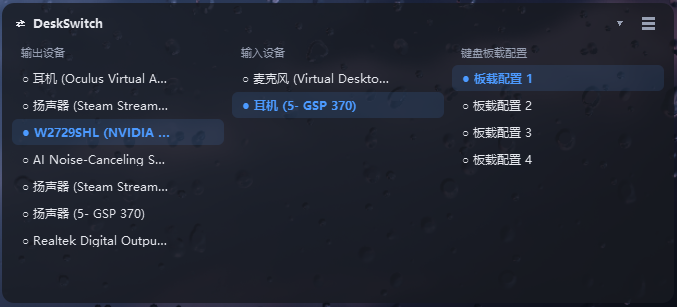

# DeskSwitch

Windows 桌面挂件：一张半透明小卡片常驻屏幕角落，点一下就能切音频设备和键盘板载配置。



## 功能

**音频输出 / 输入切换**
直接调 Windows Core Audio 的 `IPolicyConfigVista` 改默认设备，不走任何第三方工具。
设备列表每 4 秒自动刷新，插拔耳机会自动出现，当前默认设备打 `●` 标记。

**键盘板载配置切换**
通过原生 HID（usagePage `0xFF60`）给键盘发一条 32 字节命令，让固件自己在板载槽位之间切换。
整套配置（灯效 / RT / 行程 / DKS / 键位映射）一次性跟着变，约 1 秒完成，**只读不改数据**。
开发设备为**梵塔 Fuzzy 60 V2**（ATK Hub 固件），详见「兼容设备」。

**界面**
- 三列并排，窗口拉宽列就变宽、设备名自动少省略，拉窄自动省略，悬停看全名
- 右下角把手拖动改宽高；标题栏拖动换位置；`▾` 折叠成一条标题
- 右键菜单：**锁定格子（尺寸）** / **锁定位置** / **置顶显示** / 立即刷新
- 默认**不置顶**，全屏游戏和视频会正常盖住它；需要常驻最前就勾「置顶显示」
- 托盘图标左键显隐、右键菜单；支持开机自启

## 安装

依赖只有 **PyQt5**，其余（HID 读写、Core Audio COM、快捷方式创建）都是纯 `ctypes` 实现，无第三方库。

```bat
pip install PyQt5
```

启动：

```bat
:: 静默启动（无黑窗），推荐
双击 启动 DeskSwitch.vbs

:: 首次运行想看报错
双击 启动 DeskSwitch(调试).bat
```

开机自启：托盘图标右键 → 勾「开机自启」（会在 `%APPDATA%\...\Startup` 下创建快捷方式）。

## 配置

首次运行会自动生成 `settings.json`（可从 `settings.example.json` 复制）：

```json
{
  "onboard_count": 4,
  "onboard_names": { "1": "常用", "4": "游戏" },
  "always_on_top": false,
  "lock_size": false,
  "lock_pos": false
}
```

| 字段 | 说明 |
| --- | --- |
| `onboard_count` | 列出几套板载配置（默认 4） |
| `onboard_names` | 给槽位起名字，没写的显示「板载配置 N」 |
| `always_on_top` | `true` = 始终置顶；`false` = 不置顶（默认，不挡游戏） |
| `lock_size` / `lock_pos` | 锁定窗口尺寸 / 位置 |
| `pos` / `size` | 窗口位置与宽高，自动记录 |

改完在托盘或右键菜单点「立即刷新」生效。

## 命令行

```bat
python kb_onboard.py --get        :: 读当前板载配置
python kb_onboard.py --set 4      :: 切到板载配置 4
python audio_core.py              :: 列出音频设备与当前默认
python hid_core.py --usage-page FF60   :: 列出所有 RawHID 接口（查键盘 VID/PID）
```

## 兼容设备

### 已实测通过

| 键盘 | VID:PID | 固件 / 配置软件 | 状态 |
| --- | --- | --- | --- |
| **梵塔 Fuzzy 60 V2** | `373B:1267` | ATK Hub | ✅ 板载配置 1~4 读取与切换全部实测通过 |

本项目的板载配置切换功能就是在这把键盘上开发和验证的，固件为 ATK Hub。

### 其他 ATK 键盘

ATK Hub 管理下的键盘走的是同一套 VIA 风格的命令空间（RawHID，usagePage `0xFF60`），
板载配置切换用的是通用命令段，**理论上 ATK 的键盘都支持点选切换板载配置**，
差别通常只在 VID/PID 和槽位数量。

如果你的 ATK 键盘没反应，按顺序排查：

1. 枚举 RawHID 接口，确认能看到 `usagePage = 0xFF60` 这一条，记下 VID/PID：

   ```bat
   python hid_core.py --usage-page FF60
   ```

   梵塔 Fuzzy 60 V2 的输出长这样：

   ```
   VID=373B PID=1267 usagePage=FF60 usage=97 in=385 out=385  Fuzzy 60 V2
   ```

2. 把 `kb_onboard.py` 顶部的 `VID` / `PID` 改成你的；
3. 跑 `python kb_onboard.py --get`，能读回索引就说明协议对得上；读不到多半是固件版本不同，
   命令段常量（`150` / `35`）需要自行探测。

也欢迎把你试出来的型号和 VID/PID 提 PR 补充到上面这张表里。

## 适配你的键盘

`kb_onboard.py` 顶部改这三个值即可：

```python
VID = 0x373B          # 厂商 ID（梵塔 Fuzzy 60 V2）
PID = 0x1267          # 产品 ID（梵塔 Fuzzy 60 V2）
USAGE_PAGE = 0xFF60   # RawHID 接口（VIA / VIAL 通用）
```

命令帧（VIA 风格，梵塔 Fuzzy 60 V2 / ATK Hub 固件实测）：

| 操作 | 帧 |
| --- | --- |
| 读当前板载配置 | `[2, 150, 35]` → 响应 `res[4]` = 索引 |
| 切到第 N 套 | `[3, 150, 35, index]`（index **0-based**） |

这几个常量属于 VIA/VIAL 公开命令空间上的厂商扩展，实际值因固件而异，可用
`hid_core.py` 枚举设备后自行探测。

## 文件结构

| 文件 | 作用 |
| --- | --- |
| `widget.py` | 主程序（PyQt5 界面 + 切换逻辑） |
| `audio_core.py` | 音频设备枚举与切换（纯 ctypes，Core Audio COM） |
| `kb_onboard.py` | 键盘板载配置读写（原生 HID） |
| `hid_core.py` | HID 原生读写（纯 ctypes，无第三方依赖） |
| `shortcut.py` | 纯 ctypes 创建 .lnk（开机自启用） |
| `legacy/` | 已停用的早期「逐项下发」实现，见该目录 README |
| `使用说明.md` | 中文详细使用说明 |

## 已知限制

- 切换音频只改 Windows「默认设备」。已打开的声音软件可能仍占着旧设备，需要手动切过去
  （系统行为，同类工具都一样）。
- 切换板载配置时键盘会断开重连约 1 秒，期间无响应属正常。
- 同一时间只允许一个实例（命名互斥体），重复启动会自动退出。

## 说明

本项目是个人自用工具，与 ATK、梵塔（Velota）之间没有隶属或合作关系——ATK Hub 在此
仅作为键盘固件与配置软件的名称被提及。

项目只通过 Windows 公开 API 和键盘的标准 HID 接口通信，**切换板载配置的实现是独立完成的，
不需要安装也不依赖 ATK Hub 运行**；仓库不包含、也不分发 ATK Hub 或任何第三方软件的源代码。

## License

MIT
